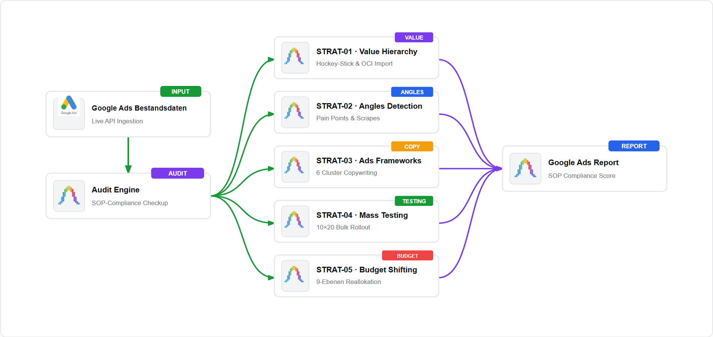

# Advanced Google Ads Audit (High Ticket Lead Gen)

[](LICENSE)
[](https://github.com/SlavaWagner)
[](https://nodejs.org)

> **Advanced Google Ads Account Audit & Strategy SOP Compliance Engine for High Ticket Lead Gen**  
> Evaluates live account architectures against 11 proprietary Standard Operating Procedures (SOPs) and provides step-by-step implementation roadmaps to reach high strategy compliance.

> [!IMPORTANT]
> **Prerequisite for AI Processing:**
> Please start Google Antigravity beforehand using the command **`agy`** in your console!
> Interactive chat sessions, asset generation workflows, and AI processing run exclusively **INSIDE the Antigravity CLI**. Outside the Antigravity CLI shell, AI processing is halted, and static execution outputs are intercepted with a guidance notice.

---

## Overview & Purpose

**Advanced Google Ads Audit (High Ticket Lead Gen)** is an autonomous AI agent system designed to check and audit Google Ads accounts against battle-tested High-Ticket Lead Generation Standard Operating Procedures (SOPs).

It connects via the **Google Ads API (v24)** using Google Cloud OAuth2 credentials, retrieves live campaign structures, conversion goals, bid strategies, RSA/PMax assets, and negative keyword lists, and evaluates percentage compliance for each strategy SOP.

---

## Architecture & Circuit Flow

<p align="center">
  
  <br>
  <em>System Circuit Architecture — <a href="docs/system-circuit.html">View interactive standalone widget</a></em>
</p>

```
 [Google Ads Account (API v24)]
               │
               ▼
 ┌─────────────────────────────────────────────────────────┐
 │ 1. Account Checkup Engine ───► Queries SearchStream for │
 └───────────────────────────┬─── live Campaigns, Budgets, │
                             │    Bidding & Asset Groups   │
                             ▼
 ┌─────────────────────────────────────────────────────────┐
 │ 2. Strategy SOP           ───► Evaluates Compliance (%) │
 │    Compliance Auditing    ──── against 11 Strategy SOPs │
 └───────────────────────────┬─── (Conversion Hierarchy,   │
                             │    PMax Signals, Angles...) │
                             ▼
 ┌─────────────────────────────────────────────────────────┐
 │ 3. Actionable Roadmap     ───► Outputs Step-by-Step     │
 │    & Report Generation    ──── Implementation Directives│
 └─────────────────────────────── Saves JSON & MD Reports  │
```

---

## The 11 Strategy SOPs Audited

The Audit Agent evaluates live account configurations against 11 proprietary Standard Operating Procedures:

1. **Conversion Value Hierarchy**: Verifies two-stage conversion tracking (CRM-verified Qualified Leads vs. raw form submissions) and daily Offline Conversion Imports (OCI) with GCLID / GBRAID / WBRAID data.
2. **Angles Detection & Competitor Intelligence**: Audits headline and description copy for rigorous pain point + solution framing extracted from competitive intelligence and landing page scraping.
3. **Ads Frameworks & Creative Copy**: Evaluates structured copy formulas (PAS, AIDA, FAB, Metaphorical Comparison) across responsive search ads.
4. **Mass Asset Testing & Creative Volume**: Audits creative testing throughput (5–10 ad variants across 6 framework matrices per campaign) and pre-production matrix filtering.
5. **AI Assets Bulk Launch & Safeguards**: Verifies bulk deployment protocol via Google Ads Editor utilizing a 10×20 architecture with strict PAUSED safeguard status.
6. **Budget Shifting & Dynamic Reallocation**: Evaluates dynamic budget shifting across 9 granular reporting dimensions to channel spend toward high-margin campaigns.
7. **Micro Location Testing & Geo Bidding**: Checks geographic targeting granularity, 1 km radius pin-drops, and postal code exclusion lists.
8. **Performance Max Audience Signals**: Audits 5 targeting tiers progressing from narrow custom intent (competitor search terms & URLs) to broad contextual signals.
9. **Target CPA Testing & Scaling**: Evaluates step-wise bidding calibration (+15% to stimulate auction competitiveness, -10% during stability) based on conversion volume.
10. **Target ROAS Calibration**: Audits target ROAS constraints in "Maximize Conversion Value" bidding based on closed deal values and conversion value variance.
11. **Artificial Budget Inflation**: Checks market dominance settings pairing 5x–10x budget headroom with strict Max CPC bid caps on low-volume, high-intent search terms.

---

## Installation & Setup

### 1. Install Globally via npm
```bash
npm install -g advanced-google-ads-audit
```

### 2. Clone Repository & Install Dependencies
```bash
git clone https://github.com/SlavaWagner/advanced-google-ads-audit.git
cd advanced-google-ads-audit
npm install
```

### 3. Setup Google Ads Credentials
Run the interactive setup assistant to configure OAuth2 credentials and authenticate your account on port 8085:
```bash
advanced-google-ads-audit setup
```

---

## CLI Usage & Commands

All commands are executed inside the Google Antigravity CLI (`agy`):

### Global Account Audit Commands

| Command | Description |
| :--- | :--- |
| `advanced-google-ads-audit audit`<br>*(Alias: `checkup`)* | Runs the complete account checkup: pulls campaigns, bidding strategies, and assets via Google Ads API v24, benchmarks them against all 11 Strategy SOPs, and outputs detailed JSON and Markdown reports. |
| `advanced-google-ads-audit agent list` | Lists all registered persistent audit agents with roles, prompts, and descriptions. |
| `advanced-google-ads-audit refresh-token` | Manually refreshes the OAuth2 Access Token for the Google Ads API. |
| `advanced-google-ads-audit setup` | Interactive configuration assistant for Google Ads API credentials (Customer ID, Client ID, Client Secret, Developer Token) and OAuth2 authorization. |

### Dedicated Strategy CLI Commands

Each of the 11 strategies can be audited individually using its dedicated CLI command:

| Strategy | Dedicated CLI Command | Primary Audit Focus |
| :--- | :--- | :--- |
| **Strategy 1** | `advanced-google-ads-audit conversion-value-hierarchy` | Two-tier conversion tracking, Qualified Lead goals, and Offline Conversion Imports (OCI). |
| **Strategy 2** | `advanced-google-ads-audit angles-detection` | Competitive landing page scraping, pain point isolation, and angle variation. |
| **Strategy 3** | `advanced-google-ads-audit ads-frameworks` | Application of PAS, AIDA, FAB, and high-ticket metaphorical frameworks. |
| **Strategy 4** | `advanced-google-ads-audit massen-asset-testing` | 5–10 ad variants across 6 framework matrices per campaign with pre-launch scoring. |
| **Strategy 5** | `advanced-google-ads-audit ai-assets-bulk-launch` | 10×20 architecture, Google Ads Editor bulk staging, and PAUSED state enforcement. |
| **Strategy 6** | `advanced-google-ads-audit budget-shifting` | 9-tier reporting analysis and weekly budget reallocation toward high-margin segments. |
| **Strategy 7** | `advanced-google-ads-audit micro-location-testing` | 1 km pin-drop radius targeting, postal code granularity, and negative location hygiene. |
| **Strategy 8** | `advanced-google-ads-audit pmax-zielgruppensignale` | 5 audience signal tiers, competitor search terms, and negative keyword lists. |
| **Strategy 9** | `advanced-google-ads-audit ziel-cpa-tests` | Target CPA adjustments (+15% stimulus / -10% consolidation) and conversion volume gates. |
| **Strategy 10** | `advanced-google-ads-audit ziel-roas-tests` | Target ROAS baseline calibration and value-based bidding progression. |
| **Strategy 11** | `advanced-google-ads-audit kuenstliche-budget-ueberhoehung` | 5x–10x budget headroom, Top of Page absolute impression share, and Max CPC caps. |

#### CLI Usage Examples:

```bash
# Run full comprehensive account audit
advanced-google-ads-audit audit

# Audit a specific customer ID
advanced-google-ads-audit audit -c 987-654-3210

# Audit a single strategy directly
advanced-google-ads-audit conversion-value-hierarchy
advanced-google-ads-audit budget-shifting
advanced-google-ads-audit pmax-zielgruppensignale
```

---

## Example Output

```text
=== Advanced Google Ads Account Audit (High Ticket Lead Gen) ===

Validating Google Ads OAuth2 Access Token...
[OK] Access Token ready.

ACCOUNT STRATEGY AUDIT SCOREBOARD:
  - Conversion Value Hierarchy         : 45% Compliance (Critical - Action Required)
  - Angles Detection                   : 70% Compliance (Sufficient)
  - Ads Frameworks                     : 60% Compliance (Sufficient)
  - Mass Asset Testing                 : 50% Compliance (Critical - Action Required)
  - AI Assets Bulk Launch              : 80% Compliance (Optimal)
  - Budget Shifting                    : 80% Compliance (Optimal)
  - Micro Location Testing             : 65% Compliance (Sufficient)
  - PMax Audience Signals              : 55% Compliance (Critical - Action Required)
  - Target CPA Tests                   : 75% Compliance (Sufficient)
  - Target ROAS Tests                  : 50% Compliance (Critical - Action Required)
  - Artificial Budget Inflation        : 60% Compliance (Borderline)

[OVERALL AUDIT SCORE]: 62.7% Compliance across High Ticket Lead Gen SOPs.

Strategy: Conversion Value Hierarchy
  Compliance Score: 45% (Critical - Action Required)
  Missing Components:
    - Two-tier conversion tracking (Qualified Lead + Closed Deal Value Import).
    - Offline Conversion Imports (OCI) via CRM / webhook integration.
  Actionable Implementation Roadmap:
    1. Create a primary conversion action "Qualified Lead" in Google Ads (restricted to CRM-verified leads).
    2. Downgrade raw form submissions to "Secondary Conversion" (observation only).
    3. Configure daily Offline Conversion Imports (OCI) with GCLID / GBRAID / WBRAID data.
    4. Switch campaign bidding strategy to "Maximize Conversion Value" with target ROAS constraints.

[OK] Complete Audit Report saved persistently to:
  JSON: storage/runs/audit-report-2026-10-31.json
  Markdown: storage/runs/audit-report-2026-10-31.md
```

---

## License

Distributed under the MIT License. See [`LICENSE`](LICENSE) for details.

---

*Created with the Google Antigravity CLI ecosystem*
